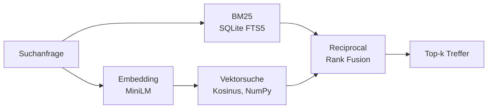

# Hybrid Search 🔍

Eine Suchmaschine für über 5.000 wissenschaftliche Abstracts, die **klassische Stichwortsuche (BM25)** und **semantische Vektorsuche (Embeddings)** kombiniert und beide Ergebnislisten mit **Reciprocal Rank Fusion (RRF)** zusammenführt. Die Suchqualität wird mit echten Relevanzbewertungen aus dem [BEIR-Benchmark](https://github.com/beir-cellar/beir) gemessen.

**Stack:** Python · SQLite FTS5 · sentence-transformers · NumPy · FastAPI · pytest

## Warum hybrid?

| | Stärke | Schwäche |
|---|---|---|
| **BM25** (Stichworte) | findet exakte Begriffe, Abkürzungen, Fachwörter | versteht keine Synonyme („car“ ≠ „vehicle“) |
| **Vektorsuche** (Embeddings) | versteht Bedeutung und Umschreibungen | übersieht manchmal exakte Begriffe |
| **Hybrid (RRF)** | kombiniert beides | etwas mehr Rechenaufwand |

RRF nutzt nur die **Ränge** der Treffer, nicht die Rohwerte. Das ist praktisch, weil BM25-Scores und Kosinus-Ähnlichkeiten auf völlig unterschiedlichen Skalen liegen:

```
score(d) = Σ  1 / (k + rang_i(d))      mit k = 60
```

## Architektur



- **Volltextindex:** SQLite FTS5 mit Porter-Stemming und eingebautem BM25-Ranking (Titel doppelt gewichtet)
- **Vektorindex:** normalisierte Embeddings als NumPy-Matrix, Top-k per `argpartition`
- **Modell:** [`all-MiniLM-L6-v2`](https://huggingface.co/sentence-transformers/all-MiniLM-L6-v2), klein und schnell genug für eine CPU
- **API:** FastAPI mit Suchseite unter `/` und automatischer API-Doku unter `/docs`

## Ergebnisse

Evaluation auf dem SciFact-Testset (300 Anfragen mit Relevanzbewertungen), Modell `all-MiniLM-L6-v2`:

| Methode | nDCG@10 | Recall@10 | MRR@10 |
|---|---|---|---|
| BM25 | 0.689 | 0.816 | 0.654 |
| Vektor | 0.648 | 0.788 | 0.607 |
| **Hybrid (RRF)** | **0.715** | **0.855** | **0.676** |

**Erkenntnisse:**
- Die hybride Suche ist in allen drei Metriken am besten: +2,6 Punkte nDCG@10 gegenüber BM25 und +6,7 gegenüber der reinen Vektorsuche.
- Auf wissenschaftlichen Texten schlägt BM25 die reine Vektorsuche, weil exakte Fachbegriffe (Gene, Medikamente, Krankheiten) viel Gewicht haben. Ein kleines, allgemeines Embedding-Modell kennt diese Begriffe schlechter.
- Die Fusion lohnt sich trotzdem: Beide Methoden finden teilweise unterschiedliche relevante Dokumente, RRF kombiniert ihre Stärken.

## Schnellstart

Voraussetzung: Python 3.9 oder neuer.

> **Hinweis für Intel-Macs:** Für Intel-Macs gibt es PyTorch nur bis Version 2.2.2. Dann nach `pip install -r requirements.txt` zusätzlich ausführen:
> `pip install "numpy<2" "transformers<4.50" "sentence-transformers<4"`

```bash
git clone https://github.com/MertErbasaran/hybrid-search.git
cd hybrid-search
python -m venv .venv
source .venv/bin/activate        # Windows: .venv\Scripts\activate
pip install -r requirements.txt

python -m search.build           # lädt SciFact + Modell, baut den Index (~2–5 Min.)
python -m search.evaluate        # vergleicht BM25, Vektor und Hybrid
uvicorn app.main:app --reload    # Suchseite auf http://127.0.0.1:8000
pytest                           # Tests (laufen offline mit Fake-Embedder)
```

API-Beispiel:

```bash
curl "http://127.0.0.1:8000/api/search?q=vitamin+D+fracture+risk&mode=hybrid&k=5"
```

## Projektstruktur

```
search/
  data.py       Download und Laden von SciFact (Korpus, Anfragen, Relevanzbewertungen)
  embedder.py   Wrapper um sentence-transformers
  index.py      SQLite-FTS5-Index, Vektorsuche, Hybrid-Ranking
  fusion.py     Reciprocal Rank Fusion
  metrics.py    nDCG@k, Recall@k, MRR@k
  build.py      CLI: Index bauen
  evaluate.py   CLI: Methoden vergleichen
app/
  main.py       FastAPI-App
  static/       Suchseite
tests/          pytest-Tests
```

## Mögliche Erweiterungen

- Cross-Encoder-Reranking der Top-20 für noch bessere Präzision
- Gewichtete Fusion (BM25 vs. Vektor) und Tuning von `k` auf einem Validierungsset
- Persistenter Vektorindex mit FAISS oder pgvector für größere Korpora

## Daten

[SciFact](https://github.com/allenai/scifact) (Wadden et al., 2020) in der Fassung des BEIR-Benchmarks (Thakur et al., 2021).
