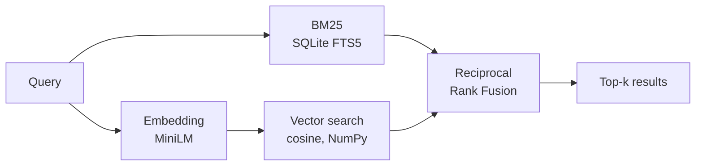

# Hybrid Search 🔍

A search engine for 5,000+ scientific abstracts that combines **classic keyword search (BM25)** with **semantic vector search (embeddings)** and merges both result lists using **Reciprocal Rank Fusion (RRF)**. Search quality is measured against real relevance judgements from the [BEIR benchmark](https://github.com/beir-cellar/beir).

**Stack:** Python · SQLite FTS5 · sentence-transformers · NumPy · FastAPI · pytest

## Why hybrid?

| | Strength | Weakness |
|---|---|---|
| **BM25** (keywords) | finds exact terms, abbreviations, technical vocabulary | doesn't understand synonyms ("car" ≠ "vehicle") |
| **Vector search** (embeddings) | understands meaning and paraphrases | sometimes misses exact terms |
| **Hybrid (RRF)** | combines both | slightly more compute |

RRF only uses the **ranks** of the results, not the raw scores. That matters because BM25 scores and cosine similarities live on completely different scales:

```
score(d) = Σ  1 / (k + rank_i(d))      with k = 60
```

## Architecture



- **Full-text index:** SQLite FTS5 with Porter stemming and built-in BM25 ranking (titles weighted 2×)
- **Vector index:** normalized embeddings stored as a NumPy matrix, top-k via `argpartition`
- **Model:** [`all-MiniLM-L6-v2`](https://huggingface.co/sentence-transformers/all-MiniLM-L6-v2), small and fast enough to run on a CPU
- **API:** FastAPI with a search page at `/` and auto-generated API docs at `/docs`

## Results

Evaluation on the SciFact test set (300 queries with relevance judgements), model `all-MiniLM-L6-v2`:

| Method | nDCG@10 | Recall@10 | MRR@10 |
|---|---|---|---|
| BM25 | 0.689 | 0.816 | 0.654 |
| Vector | 0.648 | 0.788 | 0.607 |
| **Hybrid (RRF)** | **0.715** | **0.855** | **0.676** |

**Takeaways:**
- Hybrid search is best on all three metrics: +2.6 points nDCG@10 over BM25 and +6.7 over pure vector search.
- On scientific text, BM25 beats pure vector search, because exact technical terms (genes, drugs, diseases) carry a lot of weight. A small general-purpose embedding model knows these terms less well.
- Fusion still pays off: the two methods find partly different relevant documents, and RRF combines their strengths.

## Quickstart

Requires Python 3.9 or newer.

> **Note for Intel Macs:** PyTorch is only available up to version 2.2.2 on Intel Macs. In that case, run this after `pip install -r requirements.txt`:
> `pip install "numpy<2" "transformers<4.50" "sentence-transformers<4"`

```bash
git clone https://github.com/MertErbasaran/hybrid-search.git
cd hybrid-search
python -m venv .venv
source .venv/bin/activate        # Windows: .venv\Scripts\activate
pip install -r requirements.txt

python -m search.build           # downloads SciFact + model, builds the index (~2–5 min)
python -m search.evaluate        # compares BM25, vector and hybrid
uvicorn app.main:app --reload    # search page at http://127.0.0.1:8000
pytest                           # tests (run offline with a fake embedder)
```

API example:

```bash
curl "http://127.0.0.1:8000/api/search?q=vitamin+D+fracture+risk&mode=hybrid&k=5"
```

## Project structure

```
search/
  data.py       download and load SciFact (corpus, queries, relevance judgements)
  embedder.py   wrapper around sentence-transformers
  index.py      SQLite FTS5 index, vector search, hybrid ranking
  fusion.py     Reciprocal Rank Fusion
  metrics.py    nDCG@k, Recall@k, MRR@k
  build.py      CLI: build the index
  evaluate.py   CLI: compare methods
app/
  main.py       FastAPI app
  static/       search page
tests/          pytest tests
```

## Possible extensions

- Cross-encoder reranking of the top 20 for even better precision
- Weighted fusion (BM25 vs. vector) and tuning `k` on a validation set
- Persistent vector index with FAISS or pgvector for larger corpora

## Data

[SciFact](https://github.com/allenai/scifact) (Wadden et al., 2020), as packaged in the BEIR benchmark (Thakur et al., 2021).
